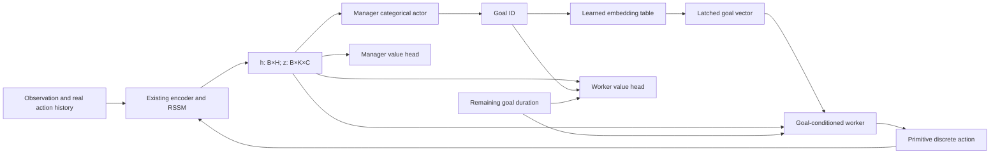

# Opt-in hierarchical actor: architecture and AMP readiness

Status: implementation and bounded regression verification; **uncommitted for
review**. No formal training or performance claim. A new annotated architecture
tag is pending implementation review and commit authorization. Existing tags and
historical checkpoints are preserved.

## Components and information flow

The world model, its RSSM and prediction/KL losses are unchanged. The flat actor
and critic remain the default. New modules compose the existing `Actor` and
`ValueHead`; no actor/critic inheritance hierarchy, registry or new dependency.



Source:

- `dreamerrl/models/hierarchical_actor.py`: actor/value composition, explicit
  policy state, guarded stepping and evaluation helper.
- `dreamerrl/training/core/hierarchical_update.py`: detached imagination,
  primitive and semi-Markov returns, actor/value losses.
- `dreamerrl/training/core/actor_critic_update.py`: opt-in dispatch; existing flat
  update mathematics remain untouched.
- `dreamerrl/training/trainer.py`: opt-in construction, collection state,
  optimizer ownership and checkpoint schema validation.
- Main PopGym/MiniHack and CAGE2 evaluation paths now own explicit local policy
  states through `policy_action`; they do not reuse collection state.

Configuration under `ActorCriticConfig`:

| Field | Default | Meaning |
|---|---:|---|
| `hierarchical` | false | Preserve the original flat path unless explicitly selected |
| `hierarchy_goals` | 8 | Manager categorical choices, at least 2 |
| `hierarchy_goal_dim` | 16 | Learned goal vector dimension, at least 1 |
| `hierarchy_interval` | 4 | Executed primitive actions per manager choice, at least 1 |

Integers are validated before environment construction in the hierarchical
trainer. Existing actor/critic widths, learning rates, discount, lambda,
entropy regularization and slow-target settings are reused. No intrinsic reward,
contrastive objective, clustering target or world-model auxiliary is introduced.

### Shapes and state

Manager input is `(h,z)` with shapes `(B,H)` and `(B,K,C)`; output is `(B,G)`
log-probabilities. A chosen goal ID `(B,)` indexes a learned `(G,D)` embedding.
Worker input is `[h,goal,remaining/interval]` of size `H+D+1` plus unchanged
factored z; output is `(B,A)` primitive-action log-probabilities.

Manager value takes `(h,z)`. Worker value takes h concatenated with fixed
one-hot goal ID and normalized remaining duration (`H+G+1`) plus factored z.
It never shares the actor-owned trainable embedding table. Both values reuse
standard symlog/two-hot value heads and their slow copies.

`HierarchyState(goal_id,goal,remaining)` belongs to a collector/evaluation/imagined
rollout, not the module. There is no additional learned recurrent state: memory
comes from the existing RSSM. The goal vector is latched, not merely re-looked-up
from the table each real step, and therefore persists across later actor updates.

`step(h,z,state,reset=mask,deterministic=...)` samples manager choices only for
rows needing a goal, executes one worker action and returns a new policy state.
The remaining count decrements only for an executed action. Inspection calls do
not advance cadence. Asynchronous row resets clear only those rows; both terminal
and truncated episodes clear collection goals before the next action. Random
warmup does not run a hidden manager clock; the first actual policy action starts
a new goal. World-model acting-state refresh does not advance hierarchy state.

Imagination reconstructs RSSM features from replay history, then begins a fresh
manager decision at each start. It does not infer or store historical replay
goals, append learned goals to observations or change replay sampling. This is
learning the current imagined policy from replay states, not off-policy learning
from recorded manager actions. Callers needing hierarchy must use explicit
`step`/`policy_action`; stateless `actor(h,z)`/`actor.act(...)` deliberately raise.

## Learning semantics and ownership

Both levels use the existing imagined extrinsic rewards. Let `d_t=gamma*c_t`,
including the configured finite-task cutoff. Worker lambda returns use primitive
steps. At future manager boundaries the value bootstrap is the manager's
pre-choice expectation; within an active goal it is the worker's conditional
value. At an imagination cutoff, bootstrap from the active worker if its goal
continues, otherwise the manager. Do not sample an extra tail goal merely to
bootstrap.

For a manager interval of actual length l:

```
R_j = sum_i=0..l-1 (product_k=0..i-1 d_(t+k)) * r_(t+i)
D_j = product_i=0..l-1 d_(t+i)
G_j = R_j + D_j * ((1-lambda)*V_next + lambda*G_next)
```

The last interval may be shorter than the configured duration. True termination
or finite-task cutoffs zero subsequent discounts while retaining the final
primitive action's reward. Truncation handling follows the existing continuing
versus finite-task configuration; collection still resets goals at episode ends.
No future replay targets enter policy features.

Worker REINFORCE scores primitive actions against worker value; manager REINFORCE
scores chosen IDs at manager decisions against manager value. Both use cumulative
continuation weights and separate existing percentile-return normalization buffers.
Lambda smoothing applies per primitive step for the worker and per manager decision
for the manager. Their policy losses are summed; each is averaged over its own
step/decision rows, so manager contributions are not accidentally diluted by
padding non-decision rows. Entropy uses the existing coefficient for each level.
Both value losses reuse two-hot targets and slow-critic regularization.

| Parameters | Optimizer | Gradient route |
|---|---|---|
| Manager actor | actor optimizer | Manager decision log-probability/entropy |
| Worker actor | actor optimizer | Primitive-action log-probability/entropy |
| Goal embedding table | actor optimizer | Worker policy recomputation with selected IDs |
| Manager and worker values | critic optimizer | Separate weighted value/slow-target losses |
| Slow value heads | None | EMA from online values; no gradients |
| World model | Existing world optimizer only | Existing world-model losses; no actor–critic gradient |

Actor, critic, world and slow-target parameter sets are disjoint. Imagination,
RSSM replay reconstruction, value baselines and targets are no-grad. Actor goal
embeddings are recomputed **outside** no-grad for worker policy learning; critic
inputs use fixed IDs. The optional flat `replay_value_scale` must remain zero in
hierarchical mode; unsupported combinations fail before environment construction.

## AMP root cause and targeted fix

On the locked Spark PyTorch 2.9.1+cu130 build, an enclosing FP16 autocast context
can cache casted FP32 weights during a no-grad forward. Reusing those cached
casts in a later gradient-enabled forward in the **same** context disconnects
that forward from the original trainable weights.

This affected two hierarchical scopes: manager/worker imagination and online
critic baseline inference. The forward losses remained finite and numerically
identical; network gradients were missing. The embedding table retained its own
route, so a loss could still require gradients while actor-network weights did not.
Checking only loss values or `loss.requires_grad` was insufficient.

The fix nests an autocast context with **`cache_enabled=False` only in those
no-grad scopes**, preserving the enclosing enabled state and selected dtype.
Grad-enabled recomputation can then obtain connected weight casts. It neither
disables mixed precision globally nor changes the flat branch, world model,
loss definitions or optimizer ownership. No duplicate training implementation or
production switch to disable the fix was added.

`test_hierarchical_amp.py` removes the cache override only with a test-local
monkeypatch, one scope at a time and then both. Each ablation reproduces the
missing gradients; retaining both guards restores all role gradients. Guarded
and ablated forward losses are exactly equal for the seeded fixtures. This is
causal regression coverage of the cache interaction on this pinned build, not a
claim about all PyTorch versions/backends.

### Measured FP32 versus AMP ownership

Three real PopGym actor–critic optimizer cycles per mode ran on NVIDIA GB10 using
the production trainer and its Adam/GradScaler path. Every parameter tensor in
the five online groups had a finite gradient; each group changed in every cycle.
Ranges below are sums of absolute **unscaled** gradients per group across cycles:

| Group | FP32 gradient L1 range | AMP FP16 range | Optimizer changes |
|---|---:|---:|---|
| Manager | 0.396–0.803 | 0.396–0.804 | Yes, all 3 cycles |
| Worker | 0.359–0.641 | 0.359–0.642 | Yes, all 3 cycles |
| Goal table | 0.00392–0.00567 | 0.00393–0.00567 | Yes, all 3 cycles |
| Manager value | 16.18–19.01 | 16.18–19.00 | Yes, all 3 cycles |
| Worker value | 20.28–22.57 | 20.28–22.57 | Yes, all 3 cycles |
| World model | No gradients | No gradients | Bitwise unchanged; 0 world optimizer steps |
| Slow values | No gradients | No gradients | EMA only; excluded from optimizers |

Both actor/critic optimizer counters advanced 1→2→3. Collection goal state also
remained unchanged across the optimization-only cycles. Numerical equality
between FP32 and AMP is not asserted; ownership, connectivity and finite updates
are the required invariants. A scalar first-cycle update is about 3e-4, consistent
with the unchanged configured learning rate; no step-size equivalence is claimed.

## Parameter comparison

For H=200, z=32×30, A=145, actor/critic widths=256, 41 value bins, G=8,D=16:

| Component | Flat | Hierarchical |
|---|---:|---:|
| Actor total | 400,529 | 770,329 |
| Online value heads | 373,801 | 749,906 |
| Slow value heads (frozen) | 373,801 | 749,906 |

Hierarchical actor consists of manager 365,320 + worker 404,881 + goal table 128.
Online values are manager 373,801 + worker 376,105. The world-model count does not
change. These are architecture counts, not measured training-speed estimates;
synthetic tests use much smaller networks and no cyber trajectories.

## Compatibility and readiness

Flat checkpoints retain schema version 4 and their original model/optimizer keys.
Hierarchical checkpoints use version 5 and an explicit configuration. Cross-mode
loads fail before model/optimizer mutation. Two preserved historical version-4
checkpoints load with exact world/actor/value/slow weights, optimizer tensors and
replay. Their bytes are rehashed before/after. This compatibility check initializes
CAGE2 adapters only to restore old checkpoints; it collects/trains no CAGE2 episode.

Goal state can be serialized separately with its matching architecture config.
Normal trainer checkpoints intentionally omit live goals and simulator state:
resume resets collector, RSSM and hierarchy together, preserving learned weights,
optimizer counters and completed replay. It is not an exact mid-episode resume.

Flat equivalence was checked against a `git archive` of clean pre-change HEAD
`3cb51a4`, with separate imported-source receipts. Fixed-seed PopGym initialization,
RNG, replay batch, losses, all gradients, optimizer updates and final
world/actor/value/slow weights matched **bitwise**, including after the AMP fix.
No historical source snapshot under runs/ is imported or executed.

Ready for review: shapes, batching, goal/phase conditioning, manager cadence,
per-row resets, persistence across actor updates, short final intervals,
finite-task masking, terminal-zero weights, gradient ownership, CPU/GPU/AMP
forward/backward, repeated optimizer steps, versioned serialization/restart,
held-out evaluation-state isolation and exact flat equivalence.

Remaining limitations:

- No formal training, task improvement, goal diversity or useful semantic skills
  demonstrated. The worker can ignore goals; goal collapse remains possible.
- Fixed decision duration; no learned termination, options discovery, hierarchical
  exploration bonus or privileged labels.
- GPU coverage is the locked GB10 FP16 build. BF16, other devices, distributed
  training and long-run overflow/GradScaler recovery are not established.
- Existing flat AMP behavior is not changed by this fix; the exact flat reference
  comparison is FP32. The new AMP ownership claims apply only to hierarchy.
- Optional flat replay-value supervision is rejected for hierarchy. Stateless
  latent probe/diagnostic tools need explicit policy-state adaptation if they
  are later used with hierarchical checkpoints; they must not silently resample
  goals every forward call.
- The CAGE2 paired-ablation initializer assumes flat actor/critic structure;
  a future CAGE2 hierarchy experiment needs a separately reviewed initializer,
  configuration, manifest and approval. The generic trainer is verified here
  with synthetic/non-cyber data, not an authorized CAGE2 hierarchy run.
- Review, commit and a new annotated architecture tag remain outstanding. Existing
  baseline/pilot tags are immutable; no new tag is created before review.

## Final verification results

- Root locked CAGE2 development profile: **33 passed** in 5.27 seconds; includes
  the five focused CUDA tests and all hierarchy/state/checkpoint tests. No skips
  on this Spark. The focused five alone passed in 2.64 seconds.
- Locked legacy profile: **102 passed** in 7.91 seconds, including those hierarchy
  checks and existing flat actor/critic, evaluation, acting-state refresh,
  repeatability, restart and observation-model regressions. These overlap the root
  tests and must not be summed as 135 independent checks.
- Ruff passed on all changed Python files; repository Pyright has zero errors or
  warnings. Existing GPU capability and legacy deprecation/marker warnings remain;
  no dependency pins were changed to suppress them.
- Exact pre-change flat reference comparison passed again after the AMP fix.
- World/RSSM/flat actor/value/imagination source and both lockfiles match HEAD;
  baseline/pilot tag objects and checkpoint bytes remain unchanged.

All learning operations were bounded synthetic or PopGym regression steps.
No formal training, new benchmark, commit or architecture tag was created.

## Reproduction and receipts

Authoritative tests:
`dreamerrl/tests/functional/test_hierarchical_actor.py`,
`test_hierarchical_amp.py` and `policy_reference_check.py`.
Generated logs and per-cycle ownership receipts:
`runs/hierarchical_amp_readiness_20261124/`.
Earlier architecture checks and clean-source reference data:
`runs/hierarchical_actor_readiness_20261124/`.

```bash
PYTEST_DISABLE_PLUGIN_AUTOLOAD=1 OMP_NUM_THREADS=2 OPENBLAS_NUM_THREADS=2 \
uv run --locked python -m pytest --rootdir=. --confcutdir=. \
  --import-mode=importlib --noconftest -c /dev/null -p no:cacheprovider -q \
  dreamerrl/tests/functional/test_hierarchical_actor.py \
  dreamerrl/tests/functional/test_hierarchical_amp.py
```

To retain new per-cycle receipts, add `--basetemp=runs/<fresh-id>/pytest_artifacts`.
Always choose a fresh path; pytest may clear an existing basetemp. GPU tests skip
on machines without CUDA, so such a run cannot satisfy the Spark AMP gate.
Historical-checkpoint tests skip when the local artifacts are unavailable.

To recreate the exact flat comparison, first archive the recorded pre-change
revision into a fresh directory outside the active checkout, then run the tracked
reference entry point from that directory with its source on PYTHONPATH:

```bash
mkdir /tmp/dreamerrl_flat_reference_review
git archive 3cb51a4 dreamerrl | tar -x -C /tmp/dreamerrl_flat_reference_review
cd /tmp/dreamerrl_flat_reference_review
PYTHONPATH=/tmp/dreamerrl_flat_reference_review OMP_NUM_THREADS=2 OPENBLAS_NUM_THREADS=2 \
uv run --locked --project /home/mspcvsp/Documents/dreamerrl python \
  /home/mspcvsp/Documents/dreamerrl/dreamerrl/tests/functional/policy_reference_check.py \
  --output /home/mspcvsp/Documents/dreamerrl/runs/hierarchy_flat_reference_review/flat_reference.pt
cd /home/mspcvsp/Documents/dreamerrl
OMP_NUM_THREADS=2 OPENBLAS_NUM_THREADS=2 uv run --locked python \
  dreamerrl/tests/functional/policy_reference_check.py \
  --output runs/hierarchy_flat_reference_review/flat_current.pt --reference runs/hierarchy_flat_reference_review/flat_reference.pt
```

The reference command must run from the archived directory; running `python -c`
from the active checkout can select current source through sys.path despite
PYTHONPATH. Source-path sidecars verify which implementation was actually loaded.
The archived source is historical reference material; authoritative verification
logic remains the tracked current entry point, never code under runs/.

Broader legacy regression reproduction:

```bash
PYTEST_DISABLE_PLUGIN_AUTOLOAD=1 OMP_NUM_THREADS=2 OPENBLAS_NUM_THREADS=2 \
UV_PROJECT_ENVIRONMENT=.venv-legacy \
uv run --locked --no-default-groups --group legacy python -m pytest \
  --rootdir=. --confcutdir=. --import-mode=importlib -c /dev/null \
  -p no:cacheprovider -q \
  dreamerrl/tests/functional/test_hierarchical_actor.py \
  dreamerrl/tests/functional/test_hierarchical_amp.py \
  dreamerrl/tests/functional/test_checkpoint_resume.py \
  dreamerrl/tests/functional/test_training_repeatability.py \
  dreamerrl/tests/functional/test_acting_state_refresh.py \
  dreamerrl/tests/functional/test_observation_model_factory.py \
  dreamerrl/tests/functional/test_minihack_evaluation.py \
  dreamerrl/tests/popgym/test_popgym.py dreamerrl/tests/popgym/test_popgym_contracts.py \
  dreamerrl/tests/invariants/test_learning_contracts.py \
  dreamerrl/tests/invariants/test_dreamer_fidelity.py
```
