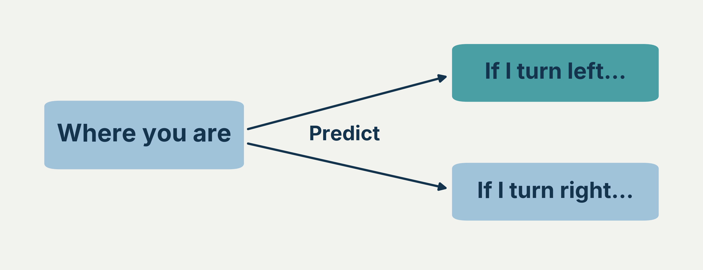
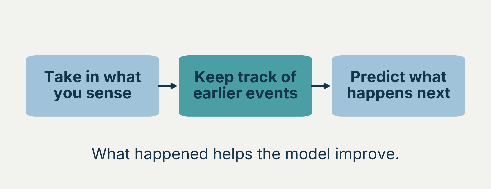
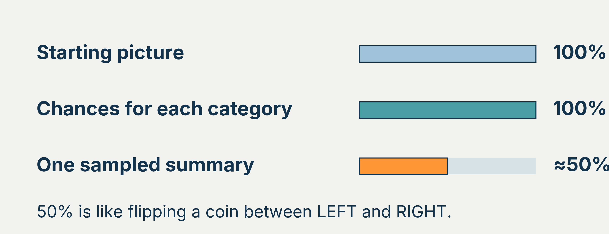
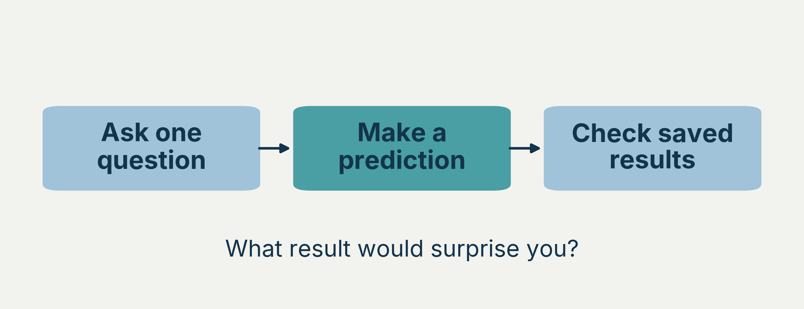

## What is artificial intelligence?

- AI can help with tasks like finding patterns or drafting code.
- Some AI systems learn from examples. Others learn by trying actions.
- In this project, I directed AI assistants to help build and study a learning agent.

## How does reinforcement learning work?

{width=94%}

Try a route to camp. Feedback helps you choose next time.

## Can AI practice in its imagination?

{width=94%}

DreamerV3 learns a world model that predicts what could happen after a choice.

## Can AI defend a simulated network?

{width=94%}

CAGE2 gives the learning agent a practice network. Activity stays inside the simulator.

## Which AI tools helped build it?

- I uploaded text to Microsoft Copilot separately from VS Code.
- I also used OpenAI Codex to help with the project.
- DreamerV3 was the agent learning from simulated experience.
- GitHub hosts the code. Git tracks its history.

## What does the human conductor do?

{width=94%}

Ask a clear question. Test the answer. Decide what to try next.

## How does an idea become a working system?

{width=94%}

I broke the problem into parts. AI helped build, debug and test them.

## How well did the agents perform?

{width=94%}

Higher scores are better. Neither design led against every simulated opponent.

## Can you remember the clue?

{width=94%}

Remember LEFT or RIGHT. I’ll cover the clue while we take eight steps.

## Where did the AI lose the clue?

{width=94%}

In this test, the model kept a faint clue until it picked one category.

## Why check a convincing result?

{width=94%}

We checked both memory and choices. The clue was readable, but choices stayed at chance.

## How can you start your own project?

{width=94%}

Explore AI with your parent or guardian, or work with an Artificial Intelligence merit badge counselor at a troop meeting.

## What skills might you build?

{width=94%}

Practice Python, explain your reasoning and learn why a test works.

## What would you test next?

- [Explore DreamerRL on GitHub](https://github.com/mspcvsp/dreamerrl)
- [Read about DreamerV3](https://www.nature.com/articles/s41586-025-08744-2)
- [Explore the CAGE2 simulator](https://github.com/cage-challenge/cage-challenge-2)

What would you build, and how would you check that it works?
