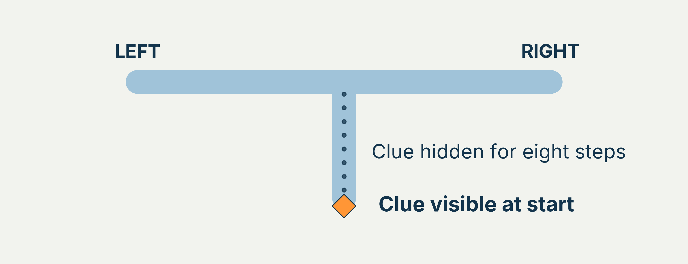
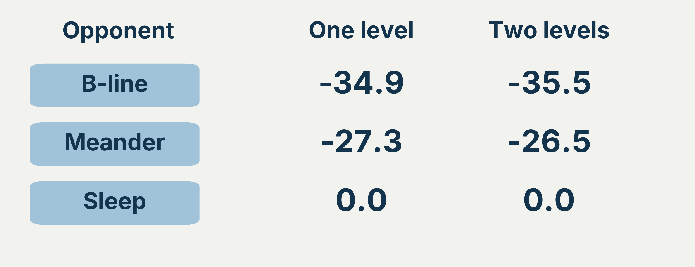
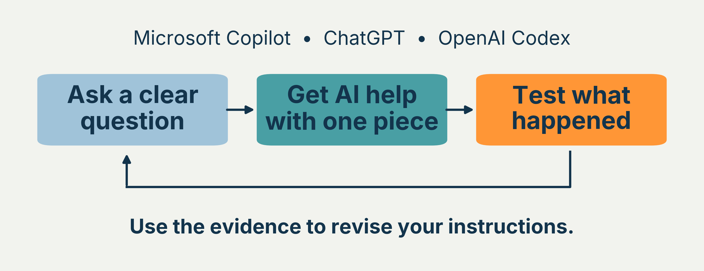

## What is artificial intelligence?

- AI systems can do things like recognize patterns, draft text, or choose actions.
- Some learn from examples. Today we’ll look at one that learns by trying actions and getting feedback.
- A learning **agent** is the part of the system that chooses what to do.

## How can AI learn by trying?

{width=94%}

Try a route to camp. Use what happens to pick a better route next time.

## Can you remember the clue?

{width=94%}

See LEFT or RIGHT once. After eight steps, which way should you turn?

## How does AI build a model of its world?

{width=94%}

DreamerV3 learns a **world model**, its own way to predict what might happen.

## Can AI practice in its imagination?

{width=94%}

DreamerV3 can practice choosing moves using its predictions.

## Can we still read the maze clue?

{width=94%}

After the model drew one compact summary, reading the clue was nearly a coin flip.

## Does remembering change the turn?

{width=94%}

With carefully chosen starting states, we could read the clue at the turn. The agents still chose correctly only half the time.

## Why might memory matter in cyber defense?

{width=94%}

Could an earlier warning help if the latest screen shows only part of what happened?

## How did the agents score in the simulator?

{width=94%}

Higher scores are better. Which design leads changes with the simulated opponent.

## Which AI tools helped build it?

- I shared text manually with Microsoft Copilot, outside VS Code, and also used ChatGPT during the project.
- OpenAI Codex helped build, debug, and test the software.
- DreamerV3 learned from simulated experience. The NVIDIA DGX Spark was the computer used to run the project.

## What does the human conductor do?

{width=94%}

As technical director, I set the goals, reviewed the evidence, and approved what to try next.

## How can you start your own project?

{width=94%}

Explore AI with your parent or guardian, or work with an Artificial Intelligence merit badge counselor at a troop meeting.

## What skills might you build?

{width=94%}

Practice Python, explain your reasoning, and learn how to design a fair test.

## What would you test next?

- [Explore DreamerRL on GitHub](https://github.com/mspcvsp/dreamerrl)
- [Read about DreamerV3](https://www.nature.com/articles/s41586-025-08744-2)
- [Explore the CAGE2 simulator](https://github.com/cage-challenge/cage-challenge-2)

What would you build, and what result would make you change your mind?
