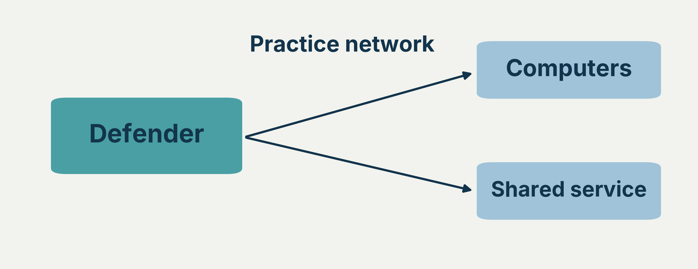
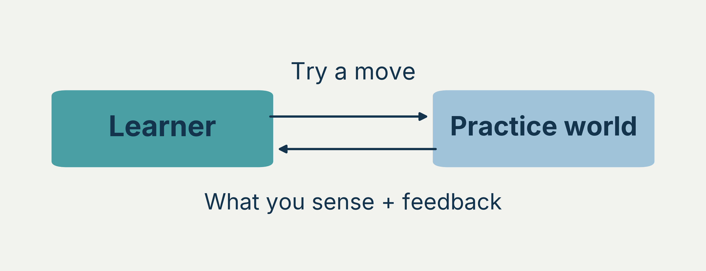
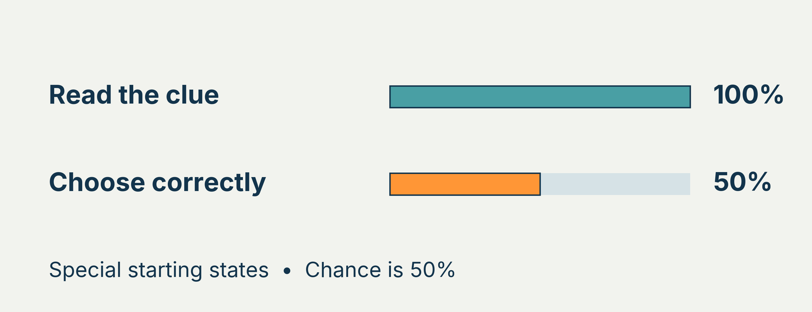
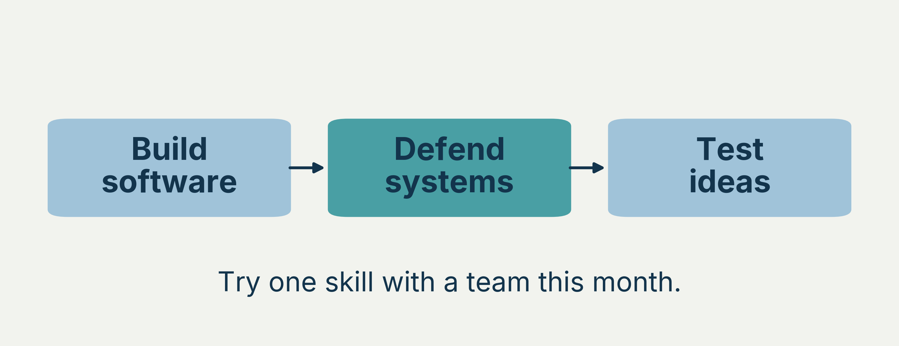

## Can AI help defend a network?

{width=94%}

A defender sees clues and has to decide what to do.

## What is reinforcement learning?

{width=94%}

The agent learns which choices tend to earn better rewards.

## Try an action. Get feedback.

- What can you see?
- What can you do?
- How will you know it helped?

Try a route to camp. The feedback helps you choose next time.

## Can an AI practice in its imagination?

{width=94%}

A world model predicts what could happen after a choice.

## Meet DreamerV3

{width=94%}

Dreamer uses its predictions to practice without taking every action in the simulator.

## How can we test cyber defense safely?

{width=94%}

CAGE2 gives a defensive agent a practice network. All activity stays inside the simulator.

## Did more planning levels help?

{width=94%}

Higher scores are better. Neither design led against every simulated opponent.

## Can you remember the clue?

{width=94%}

Remember LEFT or RIGHT. I’ll cover the clue while we take eight steps.

## Where did the AI lose the clue?

{width=94%}

The model kept a faint clue until it picked one category.

## Is remembering enough?

{width=94%}

When researchers gave the model two distinct starting states, its branch choices stayed at chance.

## How did the project come together?

{width=94%}

Python ran the tools. GitHub tracked changes. An AI assistant helped write tests.

## What can you try?

- Start with the saved T-maze result.
- Predict which stage loses the clue.
- Compare your prediction with the evidence.

Open-source tools let you begin with an existing algorithm.

## What skills might you build?

{width=94%}

Start with Python, a small project, and a teammate.

## What would you test next?

- [Explore DreamerRL on GitHub](https://github.com/mspcvsp/dreamerrl)
- [Read about DreamerV3](https://www.nature.com/articles/s41586-025-08744-2)
- [Explore the CAGE2 simulator](https://github.com/cage-challenge/cage-challenge-2)

Which clue would you keep, and how would you check that the AI used it?
